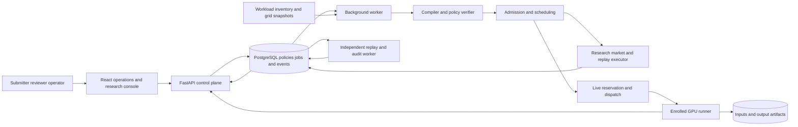

# PACT-Compute implementation plan

[Scope](#1-product-and-research-scope) · [Datasets](#2-dataset-acquisition-and-feasibility) · [Architecture and APIs](#3-system-architecture-and-interfaces) · [Methodology](#4-implementation-methodology) · [Frontend](#5-frontend-specification) · [Evaluation](#6-evaluation-and-acceptance-tests) · [Deployment](#7-deployment-and-market-pilot) · [Roadmap](#8-thirteen-week-roadmap-and-handoff)

## 1. Product and research scope

**Build a GPU job control plane for teams that need to enforce service terms and explain allocation decisions.** The first customer profile is a university AI lab or a small computer-vision team that runs urgent validation jobs alongside flexible batch inference, embeddings, and fine-tuning on shared GPU capacity. The team currently has to coordinate the queue, service deadlines, budget, and power or emissions reporting across separate tools. PACT-Compute would give the team one place to review an SLA, see why a job was accepted or deferred, verify what ran, and show the evidence to an operator or a customer.

The uploaded report and Phase 1 deck describe one system with a contract compiler, a multi-agent market, a carbon-aware scheduler, and a behavioral auditor. Their software-only research scope becomes the **Research Lab**, where controlled historical replays can expose policy mistakes, scheduling trade-offs, and pricing strategies. Add **Live Operations**, which uses the same approved policy, admission checks, and evidence model to launch an actual GPU job. Add **shadow mode** for a prospective customer, where the service receives a copy of a real queue and records recommendations with zero dispatch. This scope change requires faculty sign-off if the original software-only statement is part of the approved proposal.

| Release capability | What runs | What the evidence establishes |
| --- | --- | --- |
| Research Lab | Historical workload arrivals and resource requests, real grid data, configured buyer/provider agents, reproducible optimizer and audits | Counterfactual outcomes under documented assumptions, with controlled pricing-strategy labels |
| Live Operations | Real batch workload on an enrolled GPU, policy-based admission and dispatch, runner heartbeat, output artifact and GPU telemetry | That the full application can govern, execute and independently verify a real job |
| Customer shadow pilot | Real customer queue metadata and available capacity, recommendations recorded alongside existing outcomes | Operational fit, recommendation usefulness, forecast error and coverage before dispatch |
| Customer dispatch pilot | Approved jobs on one customer-managed cluster or GPU pool, with active reservations, bounded usage and an operator rollback path | Site-specific service and reliability under real workload, subject to access and pilot results |

### First use case

A computer-vision team produces a nightly embedding index for a new batch of images and also runs urgent quality checks. The team submits jobs with a model version, input manifest, deadline and acceptable runner. Its operator approves service terms that specify minimum GPU memory, authorized region, maximum total charge and a maximum delay for flexible jobs. The scheduler can reserve immediate capacity for an urgent check and defer an eligible embedding job into a cleaner window when the data and its deadline allow. The job page ties the output manifest and measured runtime to the exact policy revision and explains why other placements failed. A fixed urgent job provides a useful counterexample when a cleaner window would miss its deadline.

For the semester live demonstration, use the verified **NVIDIA GeForce RTX 4050 Laptop GPU with 6,141 MiB reported memory** and a pinned PyTorch/CUDA workload that fits the measured available memory. Use an allowlisted batch image-embedding template with a licensed sample or approved team-owned images. Require a real model forward pass and a downloadable, hashed output manifest with an embedding row per input. Benchmark short and longer inputs to measure startup and throughput. The driver recognized the GPU in preflight. PyTorch CUDA compatibility, process isolation, model fit, and telemetry coverage are Phase 1 checks. On this host, a single live runner can demonstrate scheduling across time and contention between jobs. A second physical pool is needed to demonstrate live cross-pool selection. The confirmed NESO data describes Great Britain. Use it for the UK scenario and for an actual GB runner if available. Map any other live runner to its verified grid zone and leave emissions unavailable until a suitable signal is configured.

**Initial market position.** Sell governance, job-level evidence, and policy-aware admission to teams that already own or rent GPUs. Test a subscription per organization or managed pool after demonstrating operator value. A prospective customer supplies its own capacity and approved images. Quoted charge and realized usage are tracked separately, with an internal rate card or reconciled provider bill when available. Kueue already supports queueing across clusters through MultiKueue, SkyPilot manages multi-cloud jobs, and Vast.ai provides a GPU marketplace API. The proposed wedge is the chain from source clause through approved policy, admission decision, execution evidence and audit, with integrations into existing infrastructure. Interview three to five prospective operators and secure one trial queue before making claims about demand or willingness to pay. [Kueue MultiKueue](https://kueue.sigs.k8s.io/docs/concepts/multikueue/) · [SkyPilot managed jobs](https://github.com/skypilot-org/skypilot) · [Vast.ai API](https://vast.ai/developers/api)

## 2. Dataset acquisition and feasibility

The raw downloads and checksums are in `PACT-Compute-data-preflight/download-manifest.json`. This is a source preflight. The application still needs a repeatable ingestion command, validation rules, dataset versioning and metrics exports.

| Source | Preflight finding | Implementation use |
| --- | --- | --- |
| Alibaba GPU v2023 pod files | Downloaded and parsed `openb_pod_list_default.csv` and `openb_pod_list_gpuspec33.csv`. Each has 8,152 pod records with 7,064 GPU requests, including 3,078 fractional GPU requests. The default file has empty GPU model requirements throughout. The `gpuspec33` variant has 2,388 GPU records with a specified model. Both have 185 `Succeeded` GPU records with ordered creation, scheduling and deletion timestamps. | Default for arrival/resource distribution. Model-constrained variant for sensitivity on the same pods. Treat both as one underlying trace. [Alibaba v2023 files and schema](https://github.com/alibaba/clusterdata/tree/master/cluster-trace-gpu-v2023) |
| Alibaba GPU v2023 node inventory | Downloaded and parsed 1,213 GPU nodes and 6,212 GPU devices. Models include P100, V100 variants, T4, A10 and unpublished G-series codes. | Calibrate a representative scaled inventory for research. Mark unpublished models as unknown for VRAM and power unless the scenario explicitly supplies assumptions. |
| NESO Great Britain | Downloaded 28 days from 1–29 October 2025. The API returned 1,345 contiguous half-hour records, including one interval just before the requested start. There were no missing `actual` values. Clip to `[from,to)` for 1,344 intervals. Also acquired a 48-period date response and a five-row sample with 14 regional forecast columns. | Primary carbon source for the GB scenario. Use the national `actual` series for retrospective scoring with the publisher's definition. Use only decision-time forecast vintages for realistic scheduling. Collect those prospectively or use a trailing-data baseline. Use regional forecasts for dispatch estimates where appropriate. [NESO national API](https://api.carbonintensity.org.uk/) · [NESO regional dataset](https://www.neso.energy/data-portal/regional-carbon-intensity-forecast) |
| Electricity Maps | Reviewed academic access requirements. The academic offering requires eligibility and limits use to approved noncommercial research. | Optional research connector with an approved account and attribution. For a commercial deployment outside open data coverage, use an authorized commercial source, with access and attribution tracked by environment. [Academic access terms](https://help.electricitymaps.com/en/articles/13168512-academic-data-access-and-availability) |
| Alibaba GPU v2026 | Inspected the release and its four-archive download guide. The hourly pod archive is about 352 GB and the job-execution summary is about 1.19 GB. | Scale-up after profiling v2023. Select a bounded execution-summary or hourly subset with a suitable staging machine. Evaluate differences in schema, runtime availability and workload mix before comparing. [Alibaba v2026 download guide](https://github.com/alibaba/clusterdata/blob/master/cluster-trace-gpu-v2026/docs/data_download.md) |
| Google Borg 2019 and Google PowerData 2019 | Reviewed access and documentation. PowerData covers 57 power domains. These are separate sources from Alibaba. | Optional BigQuery samples to study robustness and aggregate power curves. Estimate query size before querying through an authorized cloud project. Use aggregate power data at its original granularity. [Google Borg](https://github.com/google/cluster-data/blob/master/ClusterData2019.md) · [Google PowerData](https://github.com/google/cluster-data/blob/master/PowerData2019.md) |
| Green Algorithms | Reviewed the calculator and computational footprint methodology. | Reference for documenting the power model and cross-checking unit conversion, facility overhead and assumptions. [Green Algorithms calculator](https://github.com/Cambridge-Sustainable-Computing-Lab/Green-Algorithms-calculator) · [Computational carbon footprint primer](https://www.nature.com/articles/s43586-023-00202-5) |
| CUAD | Downloaded and integrity-checked its ZIP with source, test and train JSON files. | Optional external evaluation of clause evidence extraction. [CUAD release](https://github.com/The-Atticus-Project/cuad) |
| ContractNLI and LEDGAR | Downloaded and checked both archives. ContractNLI contains 607 annotated documents across its three JSON splits. The LexGLUE LEDGAR archive matches the publisher's checksum and contains a JSONL corpus. | Optional external tasks for evidence/entailment and clause category transfer. They measure legal-language capabilities in their own domains. [ContractNLI](https://stanfordnlp.github.io/contract-nli/) · [LEDGAR paper](https://aclanthology.org/2020.lrec-1.155/) · [LexGLUE release](https://zenodo.org/records/5532997) |
| PACT SLA benchmark and strategy episodes | Project datasets to be authored. The uploads provide examples and methodology. | Target 150–250 newly written and reviewed SLA examples. Generate policy variants, provider/buyer scenarios and expected behavior labels under a versioned seed and configuration. Preserve train, development and test splits. |
| Customer or lab pilot data | Collect with an operator during the pilot. Start with input sizes, queue timestamps, requested and granted resources, completion status, cost basis and power coverage. | Ground demand, runtime and savings estimates in the intended use case. Keep workload payloads, contract text and output data within the customer's authorized environment. |

The local preflight includes documentation for the v2026 and Google sources. Acquiring their data is a scale-up task. Google 2019 access requires a query project, and the selected v2026 archives are large even before extraction. Keep the local raw data for research reproduction and document publication rights for each source. Pin Alibaba files by commit and retain their checksums at import. Where public redistribution rights are unclear, publish the adapter and manifest plus appropriately licensed outputs. NESO's Carbon Intensity API lists CC BY 4.0 and has published use terms. The regional portal dataset lists the NESO Open Data Licence. [NESO API terms](https://github.com/carbon-intensity/terms) · [Regional data rights](https://www.neso.energy/data-portal/regional-carbon-intensity-forecast)

### Normalization and experiment splits

1. **Ingest and fingerprint.** Fetch only the manifest's files from approved source endpoints. Record version or upstream commit, SHA-256, URL, retrieval time, rights/attribution, schema, record count, partition selection and parser version. Write raw bytes to an immutable data directory and canonical Parquet to a versioned dataset snapshot. A dry run validates schema and reports filtered and quarantined rows with reasons. Identical input hashes and import config produce the same dataset ID.
2. **Preserve pod semantics.** Alibaba `memory_mib` is host RAM. Use `num_gpu`, `gpu_milli`, and `gpu_spec` for GPU requests. Represent explicit VRAM requirements from policies or a device catalogue. Preserve source QoS and pod phase. Validate CPU, host RAM, GPU quantities, and missing or unordered times. A pod is a trace event and may belong to a larger workload. Keep relative seconds as supplied. Anchor the replay clock onto an independently selected grid period, with the mapping visible in the run manifest. [Alibaba schema and timestamp definitions](https://github.com/alibaba/clusterdata/tree/master/cluster-trace-gpu-v2023)
3. **Define runtime cohorts before analysis.** Use `deletion_time - scheduled_time` for successful rows as a scheduling-to-deletion proxy. These 185 GPU rows had a median proxy of 3,941 seconds in the preflight and include a long tail. Keep the proxy's source visible. Use running rows as occupancy/censoring evidence, pending rows as demand only, and failed rows as a failure stress cohort. For high-volume replay, fit a documented runtime model or stratified empirical distribution using training data and independently measured batch runtimes where compatible. Mark durations from this path as modeled. Report results for the successful-proxy cohort and trace-derived demand with modeled runtimes, including sensitivity to censored durations and long jobs. A candidate solver receives a prediction at submission. The replay executor alone receives the realized runtime from the frozen experiment trace. This prevents leakage from historical completion times into the allocation decision.
4. **Split by time and scenario.** Freeze contiguous arrival windows and use independent training, tuning and test windows. Carry running jobs across boundaries using a warm-up window or report empty-start sensitivity. Stratify results by workload size, priority and duration. Use the `gpuspec33` variant as a matched sensitivity comparison and reserve live jobs for runtime calibration and execution acceptance. Record exclusions and report CPU-only counts even when the evaluation is GPU-only. Pick the final window sizes after coverage profiling. The target is 2,000–7,000 GPU arrivals for the main replay and a fast 100–300-job panel fixture.
5. **Join carbon by interval and availability.** Store `grid_zone`, `interval_start`, `interval_end`, `signal_type`, `issued_at`, `retrieved_at`, original units and methodology. Keep forecast, published actual, imputed and synthetic values visible in the UI. Test interval clipping, gaps, timezone offsets and daylight-saving transitions. For the downloaded history, use actual values only in the scoring worker or an explicitly labeled oracle. For dispatch, choose the forecast snapshot available at decision time. Historical forecast fields without confirmed issue timestamps support exploratory analysis. An implementable replay baseline can use only actual data available before the decision, with conservative publication lag. Unknown or stale data yields `unknown` for a hard emissions estimate and can defer admission, with an auditable operator path for creating a revised policy.

## 3. System architecture and interfaces

Use a React and TypeScript web app, a Python FastAPI service, Pydantic schemas, PostgreSQL with SQLAlchemy and Alembic, and a background worker. The worker handles imports, contract extraction, scheduling, experiment batches and audit replay. Use Parquet for research snapshots and S3-compatible storage for customer artifacts and results. Put DB-backed jobs and a transactional outbox in the same PostgreSQL instance initially. A separate process leases tasks, emits heartbeats and resumes expired tasks. Use HTTP server-sent events for progress and event updates, with cursor-based reconnection. The worker and web API use the same typed domain code. OR-Tools CP-SAT provides the constrained scheduling backend. [OR-Tools scheduling recipes](https://github.com/google/or-tools/blob/stable/ortools/sat/docs/scheduling.md)

The live runner pulls approved work over the authenticated API, verifies the lease and workload manifest, and reports actual lifecycle events. Keep contract extraction, dispatch and customer artifact permissions distinct. The extraction model receives policy text only when the tenant has enabled that provider. Design the text path to treat contract content as data, including embedded instructions and prompt-injection attempts. Validate constrained outputs and require reviewer activation before dispatch. Allow a manual policy form when the model is unavailable or disabled.

| Domain | Main records and rules |
| --- | --- |
| Identity and inventory | `organizations`, `memberships`, `runners`, `pools`, `inventory_snapshots`, `rate_cards`, `quota_ledgers`. Every tenant-owned row has an organization ID. Runner tokens are scoped to enrolled pools. |
| Policy | `contract_documents`, `clause_evidence`, `policy_candidates`, `policy_versions`, `validation_findings`, `approvals`. Approved versions are immutable. A reviewer correction points to a clause or records a user-authorized default and its author. |
| Execution | `jobs`, `job_attempts`, `candidate_placements`, `reservations`, `outbox`, `usage_samples`, `artifacts`. One active reservation per job. A reservation atomically claims both capacity and the cost envelope. Attempts have stable external identifiers and fencing tokens. |
| Research and audit | `dataset_versions`, `carbon_snapshots`, `scenario_versions`, `runs`, `market_rounds`, `quotes`, `decision_events`, `audit_findings`, `audit_reviews`, `automata_models`, `metrics`. Persist scenario versions, feature flags, random seeds, inputs and engine version. |

Events include `PolicyApproved`, `QuoteReceived`, `PlacementRejected`, `CapacityReserved`, `JobDispatched`, `JobStarted`, `EnergySampled`, `JobCompleted`, `ReservationReleased` and `AuditFindingRaised`. Each record carries its ID, type/schema version, source, entity IDs, organization, sequence, event time and ingest time, relevant versions, reason codes and evidence IDs. The worker writes state transition and outbox event together. An append-only log, signed export manifest and artifact hashes let an auditor check evidence integrity against a trusted export. Keep private job payloads and secrets out of shared logs. Export redacted artifacts with a retention policy and keep a disposition history for reviewed findings.

| Endpoint group | Main calls and behavior |
| --- | --- |
| Agreements | `POST /v1/contracts`, `POST /v1/contracts/{id}/extract`, `GET /v1/contracts/{id}/evidence`, `POST /v1/policies/{id}/validate`, `POST /v1/policies/{id}/approve`. Extraction is asynchronous. Edits create a new candidate revision. |
| Live jobs | `POST /v1/jobs/preview`, `POST /v1/jobs`, `GET /v1/jobs/{id}`, `POST /v1/jobs/{id}/cancel`, `GET /v1/jobs/{id}/events`. Preview returns eligibility and estimate reasons. Submission revalidates inventory, quota and quote expiry. Idempotency keys protect repeated submissions. |
| Runner | `POST /v1/runners/{id}/heartbeat`, `POST /v1/runners/{id}/leases/claim`, `POST /v1/attempts/{id}/events`. Server-generated attempt IDs, expiring leases and periodic reconciliation cover duplicate messages and uncertain execution state. |
| Research | `GET /v1/datasets`, `POST /v1/scenarios`, `POST /v1/runs`, `GET /v1/runs/{id}`, `GET /v1/runs/{id}/events`, `GET /v1/runs/compare`. Run submission returns a durable ID and progress. Results expose paired comparisons by seed and workload window. |
| Audit and export | `GET /v1/audits/{id}`, `POST /v1/audits/{id}/reviews`, `GET /v1/exports/{id}`. Authorized reviewers append disposition and rationale. Exports resolve original evidence IDs and include redaction and version metadata. |

API schemas are generated in OpenAPI and used to generate a typed frontend client. Validate cursor pagination and role/tenant authorization at the API. Keep long CPU work out of web processes. Batch research events and avoid writing every candidate or raw telemetry point to a hot relational table when a Parquet batch can retain the details. Retain individual admitted decisions, rejections that change outcome, and records referenced by a finding.

## 4. Implementation methodology

### Contract compilation and verification

1. Accept pasted English SLA text first. Preserve original Unicode text, its hash, stable paragraph IDs and a documented span-offset convention across Python and JavaScript. Add text-based DOCX and PDF import after the text workflow is reliable. Provide safe parsing and a review step if imported text loses structure.
2. Extract clause candidates in a constrained model response. Each candidate includes `actor`, `obligation`, `scope`, `predicate`, `operator`, `value`, `unit`, `enforcement_phase`, `hard_or_soft`, `exception`, and one or more cited spans. Start with minimum VRAM, GPU model/count, execution region or pool, earliest start, completion deadline, maximum deferral, rate/total charge cap, per-job estimated emissions cap or preference, and reporting obligations. Treat monthly carbon commitments and arbitrary nested exceptions as unsupported until they have precise ledger semantics.
3. Independently check that spans resolve to original text and that structured values and units agree with cited wording where possible. Parse into typed policy IR with bounded values, integer units, explicit currency, and `<` versus `≤` semantics. Convert relative times against the stated anchor and resolve explicit timezones. Keep every unsupported, missing, ambiguous or contradictory clause visible. Require resolution of any issue that could change admission. For example, “finish by 05:00” needs a timezone or an explicitly approved default. An 8-hour deferral allowance and a 6-hour deadline can coexist because the actual permitted start must satisfy both.
4. Compile to a deterministic rule evaluator and constraints used by candidate generation. Distinguish an internally inconsistent policy, a valid policy with no eligible placement in current inventory, and a viable policy. Author a reviewer checklist and use independent expected-output tests for accepted, rejected and boundary cases. Tag each rule by decision phase, including submission, reservation, dispatch, completion and reporting. Amendments produce a new policy version. Already admitted attempts keep their pinned version and receive explicit cancellation or resubmission if a human needs to change terms.
5. Activate the reviewed version and record who approved it, when, model and prompt versions, compiler version, document hash and findings. The LLM can explain from structured evidence or the app can use deterministic templates. Numerical explanations resolve directly to stored observations. A bounded TLA+/TLC model of reserve, cancel, expire and retry is a strong optional formal artifact. Check `no double reservation` and `dispatch requires active approved policy` under interleaving. [Execution-grounded extraction paper](https://arxiv.org/abs/2504.01294) · [TLA+-Bench](https://arxiv.org/abs/2607.23425)

### Multi-agent market and behavior generation

Build a discrete-event replay with arrival, market-round, placement, start, completion, expiry, supply change and telemetry events. Break ties with a stable entity ordering and split the random seed across demand, supply, runtime, agent exploration and faults. Each round reveals the jobs that have arrived and the currently available inventory. Buyers post requirements, declared budget and optional value and delay preferences. Providers post time-limited capacity offers in credits per GPU-hour. Accepted offers lock the rate and charge envelope for their reservation. A job that declines offers remains in the queue until its valid window ends. Buyer valuations and provider costs are explicit scenario inputs. [SRAP-Agent](https://aclanthology.org/2024.findings-emnlp.15/) · [Deng, Schiffer and Bichler](https://arxiv.org/abs/2406.02437)

- Implement four transparent strategy families. **Cost-plus** prices from configured marginal cost. **Scarcity-responsive** prices from its own utilization or queue pressure. **Scripted reward–punishment** switches between normal, response and recovery states when a controlled competitor action occurs. **Tabular Q-learning** chooses a markup bin from observable price, utilization and demand history, using realized profit and an idle-capacity penalty. Vary provider size, cost asymmetry, delay, churn and observation noise.
- Start with two to four research providers and supply curves that create both competitive and constrained periods. Train Q-learning on training scenarios and freeze its policy for the primary test. Test online learning in a separate condition with transparent exploration and seeds. Expose only information available at the round's decision time and test whether asynchronous quotes change results. Design the declared-price mechanism as a posted-offer allocator and document its incentive assumptions.
- Live providers contribute authorized pool capacities and rate cards. Use a quote with explicit currency, expiry, minimum billing duration, price basis, and any storage or transfer charges covered by the adapter. Keep third-party rate feeds within their terms. The live scheduler has no learning pricing authority. This supports an internal multi-pool market with attributable real rates and outcomes once a second pool is enrolled.

### Carbon-aware allocation

At each tick or important event, produce candidate triples `(job, pool or node, start interval)` from arrived jobs and current offers. Start with 15-minute planning slots and a rolling four-to-eight-hour horizon, with actual timestamps retained for audit. Include immediate and release-time starts for urgent short jobs, and measure sensitivity to slot size. Handle longer jobs using an occupancy interval extending beyond the candidate search horizon. Estimate runtime from job type, input volume and compatible hardware. Show uncertainty and include a conservative startup and duration buffer for hard deadline decisions. Refresh forecasts and capacity when making a reservation. Real dispatch uses time-bounded leases and confirms an available runner. Later placements remain tentative until they enter the commitment window.

For each candidate `a`, use a binary variable `x[a]`. Enforce at most one assignment per job and cumulative capacity per node and time interval. Count GPU devices, CPU and RAM. Enforce device VRAM, regional eligibility, quote expiry, deadline, allowed delay and rate or total budget before scoring a candidate. Research GPU sharing tracks occupancy in milli-GPU per device, independent VRAM limits when known, and same-node reservations for supported multi-GPU shapes. Stress-test trace records with fractional demand under an explicit sharing configuration. When a required device memory limit cannot be checked, mark the candidate indeterminate. The local live runner uses one exclusive GPU reservation. Support multi-GPU and topology-aware live jobs when the cluster can enforce the required capacity. Use integer minor currency units and scaled emissions with conservative rounding for hard caps. [Alibaba GPU fragmentation paper](https://www.usenix.org/conference/atc23/presentation/weng) · [OR-Tools optional intervals and cumulative constraints](https://github.com/google/or-tools/blob/stable/ortools/sat/docs/scheduling.md)

Optimize in two stages. First preserve service by maximizing priority-adjusted, on-time admitted work subject to hard rules and existing commitments. Then optimize eligible trade-offs within a declared service floor, minimizing forecast emissions, expected delay and charge with configurable normalized weights. Include an age credit or maximum wait for flexible work and a per-tenant share constraint where supported. Costs and emissions must share no implicit units. Report the weight configuration and normalization. Sweep carbon weights or use an emissions ceiling at a fixed service floor to build a Pareto plot. For each choice, retain the best competing candidate and the decisive constraint or score term. An empty feasible set produces a typed reason such as `deadline_conflict`, `capacity_unavailable`, `quote_expired`, `budget_insufficient` or `carbon_signal_unknown`.

Keep an earliest-deadline and best-fit heuristic as the operating baseline and solver fallback. Set a solver time limit, record solver status and objective bound, and revalidate feasible incumbents using an independent admission check before committing. Preserve queue positions and log timeout, infeasibility, or fallback. Test optimization correctness with brute-force enumeration for tiny problem instances. An inventory change between planning and commit triggers transaction conflict handling and a new plan. A stale plan never acquires capacity.

For carbon, estimate the energy allocated to a job in each interval from measured GPU power or a versioned per-device model. Add host or facility overhead only when the measurement boundary supports it. Define `E_interval_kWh = P_interval_kW × hours_overlapping_interval`. Apply facility PUE only to IT energy at the appropriate boundary and avoid applying it to already facility-level energy. For a factor in `gCO2/kWh`, `emissions_kgCO2 = sum(E_interval_kWh × intensity_gCO2_per_kWh) / 1000`. If a source publishes CO₂e, preserve CO₂e as the label and retain the methodology. Forecast-based admission caps are caps on the specified estimate with a configured safety margin. Record the interval coverage and uncertainty range. Compare estimates to retrospectively calculated values for completed work. Shared-device energy attribution and hardware power limits remain modeled unless backed by attributable measurement. Include energy from failed and retried work in total compute usage. [NESO carbon intensity methodology](https://www.carbonintensity.org.uk/) · [Green Algorithms methodology](https://www.green-algorithms.org/)

**Worked verification fixture.** Suppose a one-hour embedding job arrives at 01:00 UTC, must finish by 04:00, and allows two hours of deferral. Its approved cap is 0.030 kg CO₂ on the defined estimate and 4 compute credits. At 0.20 kWh of estimated energy and 2.50 credits per job, a 01:00 start with a weighted forecast of 210 gCO₂/kWh yields 0.042 kg CO₂ and fails the cap. The 02:00 start at 90 gCO₂/kWh yields 0.018 kg CO₂ and passes both caps and the deadline, assuming capacity is available. A 03:15 start fails both time rules. The preview shows each reason, the decision retains the forecast snapshot, and the monitor calculates the outcome with actual execution times and the chosen retrospective factor. These numbers are deliberately constructed for a repeatable acceptance test.

### Live execution and reconciliation

Implement the native GPU runner early. It polls the API for an approved job and receives an attempt ID, lease, pinned template version, input digest, execution deadline and authorized artifact destinations. A short real forward pass verifies CUDA availability before the first vertical slice. The runner starts the approved local workload in a supervised subprocess with a bounded execution time and resource checks. Use job-level logs, exit code, input/output counts, output checksum and timestamped GPU board power samples from `nvidia-smi` or NVML where available. Measure idle draw and telemetry coverage and label the results as GPU-board measurements. Re-run the same workload with different input sizes to check throughput and duration. Test cancellation, deadline expiry, runner restart and artifact recovery. Customer-side Linux or Kubernetes adapters can dispatch approved digest-pinned container images and collect NVIDIA DCGM metrics. [Kubernetes Jobs](https://kubernetes.io/docs/concepts/workloads/controllers/job/) · [Kubernetes GPU scheduling](https://kubernetes.io/docs/tasks/manage-gpus/scheduling-gpus/) · [NVIDIA DCGM Exporter](https://docs.nvidia.com/datacenter/dcgm/latest/installation/install-dcgm-exporter.html)

Model the execution lifecycle as `submitted → pending review or admitted → reserved → dispatched → running → succeeded, failed, cancelled or expired`. Include an `execution_unknown` state when an acknowledgement or heartbeat is lost. Reconcile runner status before retrying potentially running work, and use lease fencing to reject writes from stale attempts. Release capacity and reconcile budget using confirmed final state or an explicit operator disposition. Retry a transient failure only within remaining deadline and budget. Keep all attempts, with usage and output provenance for the successful attempt. For any hard total charge cap, the runner must be able to bound the authorized spend with a reserved envelope and max duration. Where a provider rate or usage cannot be bounded, route to review or decline the placement.

### Independent monitoring and behavior auditing

**Compliance monitor.** Replay original policy version, inventory, quote, reservation, usage and outcome events. Use separate temporal checks for actual obligations, including valid policy at dispatch, region and hardware eligibility, capacity overlap, deadline outcomes, price cap and required reporting. Produce `pass`, `fail` or `unknown` per rule and attach actual versus expected values, source span, event IDs and evidence completeness. A known deadline miss after runner failure is an SLA outcome even when the planned start was admissible. Test with deliberately altered replay fixtures where dispatch occurred without a valid approval or cost was charged twice. Preserve differences between prevention by admission and detection by the independent monitor.

**Automata auditor.** Construct per-provider sequences from time-aligned public or authorized observations. Fit context bins on training data for demand pressure, available supply, relative markup, price change, competitor undercut, persistence and recovery. Compare prices against a context-matched cost-plus or scarcity-responsive reference. Where reliable costs are missing, estimate a historical reference from available context and report coverage. Build a prefix-tree transducer from observed context and action sequences, then merge states with compatible next-action distributions and transition structure. Select minimum support and model complexity on development data. A smaller rule-defined automaton supplies an interpretable baseline. At test time measure next-action fidelity and unseen-transition rate, with transition counts and representative original rounds visible in the graph. Keep hidden strategy labels and private Q-tables out of auditor inputs.

**Alert evidence.** Require repeated state sequences, enough support and a response that persists after matching on comparable demand and supply. Compare against correlation, high markup and a context-only classifier. Test provider exit, rising input cost, seasonality, synchronized scarcity and feed delays as negative controls. In research, intervene with a single provider undercut under identical exogenous seeds and inspect whether the response and recovery differ from the untouched episode. Calibrate the alert threshold and an abstention rule on validation scenarios. Route live pricing or policy-pattern alerts to internal review with a statement of observed behavior and evidence IDs. Customer pilot alerts concern permitted observations, such as repeated breaches of a disclosed pricing or quote policy. Ground-truth coordination labels exist only for deliberately generated strategies and controlled interventions. [Pricing strategy study](https://arxiv.org/abs/2406.02437) · [Policy state abstraction research](https://proceedings.mlr.press/v222/bekkemoen24a.html)

## 5. Frontend specification

Use an operator console with accessible tables, linked timelines and consistent evidence drawers. Add a mode selector with **Live Operations**, **Shadow** and **Research Lab**, and keep the mode, policy version and data origin visible on results. Use Plotly for comparison and emissions charts and React Flow for the automaton graph. The critical user actions are submit, approve, compare and inspect evidence. Give each view empty, loading, stale, partial and failed states, along with clear keyboard navigation. Default the tenant submitter to their jobs, the reviewer to policy and finding queues, and the operator to capacity and dispatch.

| Screen | What users do and what they can verify |
| --- | --- |
| Agreements | Paste SLA text. Review clauses beside highlighted source spans and normalized values. Inspect missing units or contradictions, resolve the issue, run validation and activate a version with an approval record. |
| Job submission and preview | Select an approved workload template, manifest, policy and budget. Compare proposed pool, timing, price envelope and estimated emissions. Expand rejected candidates to see the exact clause and the observed limit. Submit or save the preview for review. |
| Operations queue and capacity | Monitor tenant queues, job states, reservation timeline and GPU occupancy. Inspect stale runners and contention. Pause dispatch, cancel a job or resolve an uncertain attempt as an authorized operator. |
| Job evidence | See the original SLA clause, pinned policy, decision and actual timestamps. Inspect runner output, telemetry coverage, estimated or reconciled charge and artifact hash. Download the output and the signed evidence bundle. |
| Research scenario and replay | Select a frozen dataset and timeframe, strategy mix, seeds and carbon inputs. Clone a scenario and change one input. Scrub offers, queue events and scheduler placements. Show assumptions and origin badges beside source-derived and modeled values. |
| Carbon and experiment comparison | Display forecast and historical series, shifted job intervals and energy boundaries. Compare service, cost, fairness and emissions on matched workload windows. Show per-seed scatter, uncertainty and the service-constrained Pareto curve. Export CSV and figures. |
| Strategy and audit review | View the context and transitions behind an alert, compare a legitimate scarcity example, click through to raw evidence and record disposition. Show observed compliance outcomes and behavior patterns in separate fields with distinct status vocabulary. |

## 6. Evaluation and acceptance tests

### Experimental design

| Question | Controlled comparison | Primary outcomes |
| --- | --- | --- |
| Does reviewable extraction help? | Regex/templates, direct structured LLM extraction and two-stage source-linked extraction with deterministic verification. Score before and after human review on a held-out set grouped by SLA family. | Exact rule match, rule F1, unsupported-rule and false-activation rate, ambiguity abstention, evidence span accuracy and reviewer time. |
| Does policy enforcement improve service? | FCFS, earliest-deadline best-fit and CP-SAT. Use shared physical constraints and common job arrivals. For the policy ablation, keep the scheduler fixed and toggle enforcement of the additional SLA rules in Research Lab. Evaluate every condition with the same independent monitor. | Hard-rule violations per admitted job and per applicable rule, refusal/deferment rate, on-time completions per submitted job, throughput, wait p50/p95 and utilization. |
| Does carbon-aware scheduling help? | Compare the same policy-aware solver with and without a soft carbon objective, keeping explicit hard caps identical. Separately sweep caps and forecast error. Include a hindsight oracle as an upper-bound reference and a carbon-blind greedy baseline. | Energy, total and per-job emissions, matched-completion emissions, on-time completion, wait, and subgroup impact. Score both conditions on the same retrospective signal. |
| Does the audit identify strategy patterns? | Matched-context threshold and price-correlation baselines, expert-defined automaton and learned automaton. Hold out episodes and scenario families. Include fixed and adaptive strategies, scarcity, costs, exits and noisy observability. | Precision, recall, macro-F1, precision-recall AUC, false-positive rate during legitimate scarcity, detection delay, coverage, state count and next-action fidelity. |
| Can the system run and verify a real job? | Native GPU test suite, two job sizes, concurrent submissions, one infeasible SLA, runner restart and one injected failure. Compare artifact content and logs against known input and policy conditions. | Actual CUDA execution, output correctness, independent audit agreement, retry/cancellation integrity, telemetry coverage and prediction error. |

Freeze the initial SLA corpus at roughly 150–250 examples, with a 30–40-item pilot and deliberate inclusion of exceptions, negation, contradictory limits, timezones, unit conversions, infeasible resource requests and malicious embedded instructions. Two people independently review a stratified subset including high-impact clauses, then adjudicate disagreement. Split by template or paraphrase family so near-duplicates cannot cross the boundary. Record annotation definitions and inter-reviewer agreement. Score strict activation correctness on a frozen set before proposing live use.

Use common random numbers and the same arrival, supply, disruption and grid inputs for paired scheduler comparisons. Train or tune on development scenarios, freeze configurations and run the final evaluation over multiple held-out windows and about 30 paired seeds per core condition if runtime permits. Treat the seed/window or full episode as the unit of uncertainty, report paired bootstrap intervals and include negative results. Preselect primary outcomes and distinguish exploratory sensitivity plots. Isolate the audit's effect on detection with paired logs. If alert-driven operator intervention is tested, define the intervention and measure it in a separate experiment. Give each export the dataset hashes, environment lock, configuration, seed, engine version, carbon signal version, and analysis script revision.

Compute buyer surplus as completion value minus payment and specified delay cost. Compute provider profit as payment minus defined incremental costs. Use their sum for modeled total surplus, avoiding counting the same transfer twice. For fairness report per-tenant or per-priority completion rates, normalized wait and Jain's index over a predeclared service measure with explicit handling of all-zero outcomes. Report admission and all-submitted denominators so a scheduler cannot look better by rejecting hard jobs. For carbon compare total emissions alongside completions, matched-job emissions and per-completion emissions. Report telemetry and estimate coverage alongside all carbon results.

### Proposed release gates

| Gate | Pass condition |
| --- | --- |
| Data and reproducibility | A clean import reproduces the input counts, checksums and version IDs. A frozen run reproduces decisions and metrics with the documented deterministic solver configuration. Use bounded deterministic solver work for reproducibility runs and report wall-clock limits for operations. |
| Policy correctness | Every rule category has positive, negative and exact-boundary checks. Every activated rule has source evidence or an explicit approved default. The independent monitor catches the seeded forbidden dispatch, double-reservation, duplicate-charge and missing-report cases. |
| Real execution | From the web app, approve an SLA, submit a live GPU job, retrieve a correct output artifact, and trace its hash, job timestamps, CUDA evidence and policy version. A conflicting policy fails admission with the relevant source clause. |
| Reliability and isolation | Duplicate submissions and repeated callbacks produce a single active reservation. Lease loss or restart reconciles before a duplicate dispatch. Tenant A cannot access Tenant B's jobs, artifacts, policies or streams. Restore a backup into staging and replay an exported run. |
| Responsiveness | Proposed development targets are a panel fixture result in under 60 seconds and a job preview p95 under two seconds at a declared queue size with the configured fallback. Record actual hardware, workload, latency and bottleneck. |
| Research evidence | Results include the full baseline matrix, held-out uncertainty, low-data abstention, known negative controls, and at least one examined failure case per major subsystem. The semester result remains useful if a hypothesis fails. |
| Customer pilot | Operator approves a defined runner, quota, emergency stop, tenant isolation, retention and charge policy. Agree on baseline and success metrics before shadow mode. Require no unexplained dispatches, verified artifact evidence and satisfactory shadow coverage before enabling a tightly bounded subset of live jobs. |

Use pytest for unit and state-machine tests, property tests for scheduling/resource/money invariants, PostgreSQL integration tests for concurrent claims and rollback, Playwright for browser workflows, and actual CUDA smoke tests as a separate hardware-dependent job. Add API tests for unauthorized access, expired runner credentials, invalid callbacks and exports. Add end-to-end tests for malformed uploads, carbon outages, worker interruption and solver timeouts. Trace every test in the teacher's evidence appendix to the rule or release gate it covers.

## 7. Deployment and market pilot

- **Semester installation.** Run the frontend, API, worker, database and artifact service in a reproducible local stack. Use native Windows for the first GPU runner and lock the Python/CUDA environment. The preflight confirmed `nvidia-smi` and `wsl.exe` are available. Docker and `kubectl` were absent from the current shell path. Check WSL distribution and container availability after approval. Provide a native service startup path or install the agreed container runtime if needed. Include seed data, database migration, demo runbook, and a recorded fallback run with a verified artifact.
- **Staging.** Deploy the control plane behind HTTPS with OIDC login and role-based access. Isolate environments and the Research Lab's agent settings. Use expiring scoped credentials for runners, keep an outbound-only runner connection, restrict workload images/templates, and keep raw datasets outside served web roots. Publish a read-only academic demo separately if a public URL is needed. Keep any enabled live dispatch behind authenticated roles, a registered runner and explicit quotas.
- **Customer pilot.** Start with one willing lab or team, one workflow and one enrolled runner or cluster. Obtain a sample queue and characterize typical wait, missed deadlines, job sizes, utilization, manual operator work and available power coverage. Run one to two weeks of shadow recommendations where data and access allow, then offer an opt-in controlled dispatch trial for low-risk flexible jobs. Compare to the customer's existing workflow using paired jobs where feasible. Define a rollback to the current queueing path and rehearse the stop procedure with the operator.
- **Operations.** Collect traces and metrics for queue depth, reservation age, solver timeouts, heartbeat delays, incomplete evidence, telemetry gaps and reconciliation errors. Alert operators for stuck leases, repeated admission failures and missing audit evidence. Back up policy and event data, exercise restore, rotate secrets and record rollback steps for schema or code releases. Customer data access, retention, supported locations and permitted carbon data sources belong in onboarding.
- **Commercial rollout.** Expand only after the pilot measures repeatable value, for example reduced operator effort, more flexible workload accommodated under the same service limits, or better evidence for billing disputes. Add a second adapter only after the first proves stable. Pursue metered provider integrations and billing reconciliation in sequence. A public multi-provider marketplace would also require supplier onboarding, payments and settlement, commercial terms, incident response and operator coverage. Treat those as a later release with its own scope and validation.

## 8. Thirteen-week roadmap and handoff

The sequence assumes roughly four contributors, matching the report's suggested split. One person can implement the sequence by keeping the native runner, policy DSL, core research agents and audit console on the critical path, then scheduling additional adapters, external benchmark experiments and formal model checking after the main gates.

| Weeks | Work package | Evidence at the milestone |
| --- | --- | --- |
| 1–2 | Source manifest and normalization, GPU/CUDA spike, domain schema, service boundaries, first real runner execution, initial customer interviews | Versioned workload snapshot, documented runtime gaps, verified GPU result with artifact checksum, candidate workload and operator workflow |
| 3–4 | First vertical slice with React job form, FastAPI, database, worker, manual policy, admission, native dispatch and evidence view | Submit a real GPU job from the web UI and verify the artifact. Demonstrate failure or cancellation and a safe retry. |
| 5–6 | Evidence-linked extraction and approval, policy checks and benchmark labelling, FCFS and deadline/best-fit replay baselines | An approved policy revision can govern both live and replay paths. Capture labeled ambiguities and hard-rule boundary cases. |
| 7–8 | Posted-offer market and strategy baselines, carbon source adapter, bounded rolling CP-SAT optimizer, comparison UI | Reproduce a baseline and an optimized run with matched inputs. Explain one rejected or delayed job and the exact estimate used. |
| 9–10 | Independent monitor, learned automaton and negative controls, scenario replay and export, runner reconciliation tests | Contract violations, legitimate scarcity, and a scripted response/recovery pattern each have reproducible evidence. |
| 11–12 | Final benchmark and ablations, stress and security tests, staging deploy, pilot preparation and shadow intake if available | Frozen experiment manifests, uncertainty tables, clean deployment runbook, backup/restore and rollback exercise, pilot baseline or documented access dependency. |
| 13 | Faculty demonstration, final report, reproducibility review and market pilot handoff | Live GPU evidence, trace-driven replay comparison, code and data cards, protocol and architecture, measured results, release and pilot next steps. |

Assign ownership by domain. One contributor owns policy extraction and benchmark labels, one owns the market and behavioral audits, one owns data, scheduling and GPU telemetry, and one owns API/UI integration, deployment and acceptance testing. Pair each owner with an independent reviewer for its highest-risk interface. Bring the groups together on the vertical slice in weeks 3–4 before expanding individual modules.

### Faculty demonstration

1. Submit an SLA with a missing timezone and show why activation needs clarification. Resolve the issue, approve the policy and open the relevant evidence spans.
2. Submit a real image batch against the enrolled GPU. Show the reservation, GPU job logs, result and artifact hash. Submit a second job with an incompatible memory requirement and inspect the rejected placement.
3. Replay a frozen Alibaba workload and the NESO series with the same workload and policy under two schedulers. Inspect one flexible job, the effect on wait and emissions, and the trade-off curve. Show which inputs were observed or modeled.
4. Display a scripted pricing-pattern alert and a legitimate scarcity scenario. Open the state-transition evidence and then inspect a separate policy violation detected from a replay event. Export the manifest and show how an evaluator can reproduce the run.

The final project package will include runnable frontend and backend source, a GPU runner, policy specification, verified source adapters, the reviewed SLA dataset, versioned research configurations, test outputs, measured live-run artifacts, baseline and ablation tables, and installation and operation instructions. Target an IEEE-style paper or research proposal supported by the completed evaluation. Verify related work and narrow the novelty claim to the contribution the experiments support. The Phase 1 slide that uses Wu and Tu's KV-cache paper as evidence for resource-allocation agents should cite Ji et al.'s SRAP-Agent for that point. Use Deng, Schiffer and Bichler for arXiv:2406.02437, as the deck's reference slide already does. [Wu and Tu paper](https://arxiv.org/abs/2405.10637) · [SRAP-Agent](https://aclanthology.org/2024.findings-emnlp.15/) · [Pricing paper](https://arxiv.org/abs/2406.02437)
